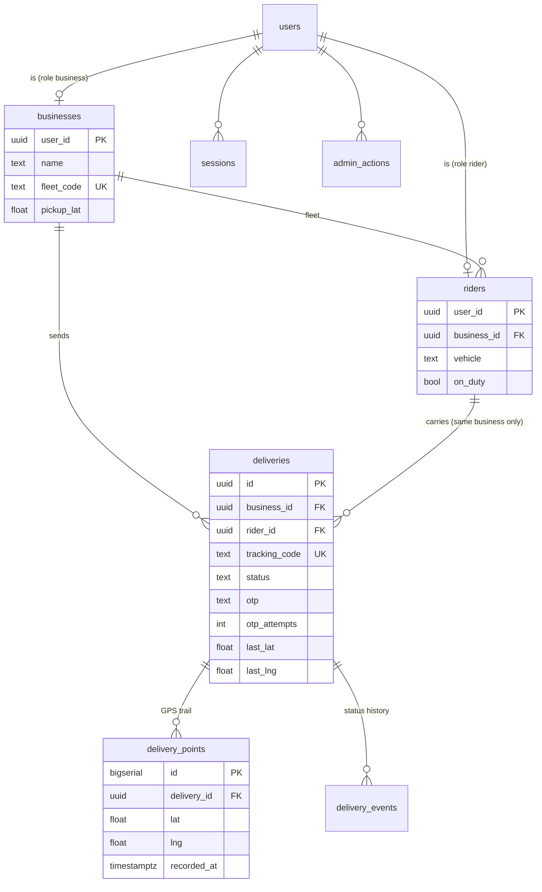
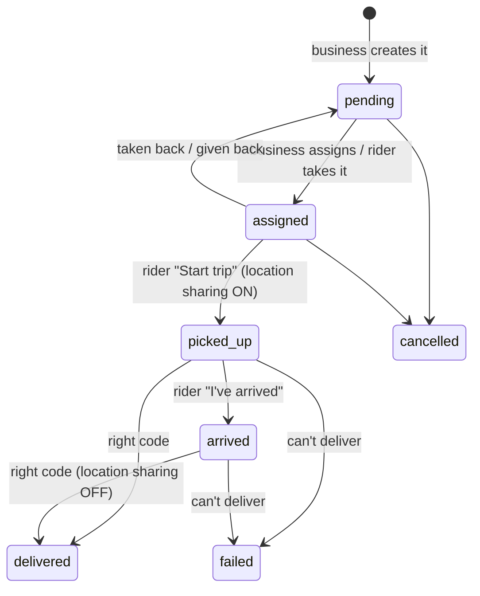

# Wo Ọ̀nà

**Day 25 of my 30-day dev challenge: a live delivery tracker.** Learning focus: **real-time updates and location.**

*Wo ọ̀nà* is Yoruba for "look at the road". To *watch the road* for someone means you're waiting for them to arrive, which is exactly what a customer does while their parcel is on its way.

A business creates a delivery and sends the customer a tracking link on WhatsApp. A rider takes the job on their phone and taps **Start trip**; from then until the handover, the phone sends its GPS position every few seconds. The customer opens the link (no app, no account) and watches the rider move towards them on a map with a rough arrival time. At the door, the customer reads a 4-digit code to the rider, and only the right code completes the delivery.

- **Stack:** Next.js 16 (App Router, Cache Components) · TypeScript · Tailwind CSS v4 · PostgreSQL on Neon (plain SQL, no ORM) · Zod · Pusher Channels · Leaflet + OpenStreetMap · Vercel Blob · Resend
- **Colours:** white 60% · cobalt blue `#1446C8` 30% · black `#0B0B0C` 10%, plus small green/red status badges; light and dark mode

---

## 1. Run it locally

You need Node.js 20.12 or newer and a Neon account.

```bash
npm install
cp .env.example .env.local     # then fill in the values (see section 2)
npm run db:migrate             # creates the tables (safe to run twice)
npm run db:seed                # two businesses, riders and deliveries (safe to run twice)
npm run check:rules            # proves the rules; should print "47 passed, 0 failed"
npm run dev                    # http://localhost:3000
```

On Windows with Git Bash, these commands work as they are.

**Run `check:rules` against a test or local database, not production.** It creates throwaway accounts and deletes them at the end, but there's no reason to do that on the live database.

**Testing GPS on your phone needs HTTPS.** Browsers only share location with secure pages, and `http://192.168.x.x:3000` isn't one. Test the real-GPS part on the deployed Vercel site. Everything else (and "Simulate ride") works on localhost.

## 2. Connections and environment variables

| Variable | Required | What it is |
|---|---|---|
| `DATABASE_URL` | Yes | Neon **pooled** connection string. In Neon: create a project (region **AWS Europe (Frankfurt)**), then *Connect* → tick *Connection pooling* → copy. |
| `APP_URL` | Yes | `http://localhost:3000` locally; your live URL on Vercel. Used in tracking links, rider invites and emails. |
| `NEXT_PUBLIC_PUSHER_KEY` | No* | Pusher app *key*. |
| `NEXT_PUBLIC_PUSHER_CLUSTER` | No* | Pusher cluster, e.g. `eu`. |
| `PUSHER_APP_ID` | No* | Pusher app *app_id*. |
| `PUSHER_SECRET` | No* | Pusher app *secret*. Keep it private: server only. |
| `BLOB_READ_WRITE_TOKEN` | No | Vercel Blob token. When set, riders must take a photo of the parcel at the door. |
| `RESEND_API_KEY` | No | From Resend → *API Keys*. Empty = emails are printed in the terminal. |
| `EMAIL_FROM` | No | `Wo Ọ̀nà <onboarding@resend.dev>` until you verify your own domain in Resend. |
| `ALLOW_SIMULATED_TRIPS` | No | `true` lets any rider use **Simulate ride** (good for a portfolio). Demo accounts can always simulate. Set `false` for a real fleet. |
| `CRON_SECRET` | On Vercel | Any long random string. Vercel Cron sends it to the daily clean-up. |
| `SEED_USER_PASSWORD` | For seeding | Password for every seeded business and rider (8+ characters). |
| `SEED_ADMIN_PASSWORD` | For seeding | Password for the seeded admin (8+ characters). |

\* **Pusher is optional but recommended.** Without it, every page still updates by checking the server every 3 to 5 seconds. With it, the rider moves on the customer's map the moment the phone sends a point.

**Setting up Pusher (about 3 minutes):**
1. Sign up at pusher.com (the free *Sandbox* plan is enough).
2. *Channels* → *Create app*. Name it `wo-ona`, choose the **eu** cluster, front end *React*, back end *Node.js*.
3. Open *App Keys* and copy `app_id`, `key`, `secret` and `cluster` into the four variables above.
4. In *App Settings*, leave **Enable client events** switched off: browsers only listen, and only the server sends.

**Setting up Vercel Blob (photo proof, optional):** in your Vercel project, *Storage* → *Create* → *Blob* → connect it to this project. Vercel adds `BLOB_READ_WRITE_TOKEN` for you. To use it locally too, copy the token into `.env.local`.

**Resend notes.** Until you verify a domain, Resend only delivers to the email address you signed up to Resend with. Seed and demo accounts use `@example.com` addresses, and the app never sends to those; their emails are printed in the terminal. The business gets an email when a delivery is delivered or fails.

## 3. Deploy to Vercel

1. Push this folder to GitHub as `30days-25-wo-ona-delivery-tracker`.
2. In Vercel: *Add New → Project* → import the repo. Name the project `wo-ona-delivery-tracker`.
3. Add every variable from section 2 **before the first deploy** (the `NEXT_PUBLIC_` ones are built into the page code, so changing them later needs a redeploy). Set `APP_URL` to the Vercel URL. Skip the `SEED_*` variables; they're only used on your machine.
4. The region is already set to **Frankfurt (fra1)** in `vercel.json`, next to the Neon database.
5. Deploy. Then migrate and seed from your machine, with `DATABASE_URL` in `.env.local` pointing at the **same** Neon database Vercel uses (check *Settings → Environment Variables*; on earlier days the Neon integration created a different, empty database).

`vercel.json` also schedules a daily clean-up (`/api/cron/cleanup`, 03:00 UTC): it deletes demo worlds older than 24 hours and GPS trails of deliveries that finished more than 7 days ago.

## 4. Demo accounts

After `npm run db:seed`. Every seeded account uses `SEED_USER_PASSWORD`, except the admin.

| Role | Email | Has |
|---|---|---|
| Business | `swift@example.com` | **Swift Errands Lagos** (Yaba). Fleet code `SWFT24`. A trip on the road, one assigned, two waiting, delivered and failed ones |
| Rider | `musa@example.com` | Swift Errands. A job to collect (Yaba → UNILAG): start it and **Simulate ride** |
| Rider | `tunde@example.com` | Swift Errands. On a trip (Yaba → Ikeja City Mall) |
| Rider | `ngozi@example.com` | Swift Errands. Delivered one today |
| Business | `coalcity@example.com` | **Coal City Couriers** (Enugu). Fleet code `ENUGU7` |
| Rider | `chinedu@example.com` | Coal City. On a trip (Polo Park → UNEC) |
| Rider | `amaka@example.com` | Coal City. A job to collect |
| Admin | `admin@example.com` (`SEED_ADMIN_PASSWORD`) | The admin panel |

Or press **Try the live demo** on the home page. Each click builds a private business just for you, with three riders and five deliveries, deleted after 24 hours. A blue bar lets you **switch** between the owner and the riders, so one visitor can play every part:

1. As the owner, open Adaeze's delivery and press **Open tracking page** (new tab): that's the customer's view.
2. Switch to **Musa**, open his job, tap **Start trip**, then **Simulate ride**.
3. Watch the tracking tab: Musa moves along the road. At the end, tap **I've arrived** and enter the 4-digit code shown on the tracking page.

## 5. Diagrams

### Database schema



### A delivery's statuses



### How one GPS point reaches the customer

```mermaid
sequenceDiagram
  participant Phone as Rider's phone
  participant API as /api/rider/location
  participant DB as Postgres
  participant P as Pusher
  participant C as Customer's tracking page
  Phone->>Phone: watchPosition() fix; keep if moved 8 m or 15 s passed
  Phone->>API: POST batch of up to 20 points (every 3 s)
  API->>DB: check: this rider, this trip, trip is live
  API->>DB: INSERT points; move "current position" forward only
  API-->>Phone: 200 { accepted, dropped }
  API->>P: after(): trigger "point" on track-CODE
  P-->>C: WebSocket message
  C->>C: rider marker glides to the new spot, ETA recalculated
  Note over C: No Pusher? The page fetches /api/track/CODE every 3 s instead
```

## 6. Who can see and change what (the ownership checks)

Every Server Action and API route checks **who you are** (the session) and **whether the record is yours**. Services never trust an id from the browser: a Server Action is a public endpoint that anyone can call with any id.

- **A business sees only its own deliveries and riders.** Every query says `WHERE business_id = $me`. Another business's delivery id gives **404, not 403**, so nobody can probe which ids exist.
- **A delivery can only go to a rider of the same business.** Checked in the service, and also by the database: a **composite foreign key** `(rider_id, business_id) → riders (user_id, business_id)` rejects any other combination, even from a buggy query.
- **A rider sees only their own fleet's job board,** and can only open, start, finish or report trips assigned to them (`WHERE rider_id = $me`).
- **Only the assigned rider can send location, and only during the trip** (`picked_up` or `arrived`). Before pickup and after the handover, points are refused.
- **The customer's tracking page** is opened by the code alone (no account). It never contains phone numbers (only the business's), the rider's surname, or other deliveries. After the handover it shows no position or route at all. Look-ups are rate limited (120 a minute per network) against code guessing.
- **The rider never sees the 4-digit code.** Five wrong codes lock it until the business issues a new one.
- **Private real-time channels:** `private-business-<id>` only for that business, `private-fleet-<id>` only for its riders. Pusher asks `/api/pusher/auth`, which checks the session.
- **Riders join a fleet only with its current fleet code.** Demo fleets and paused businesses accept nobody.
- **Admins** can pause businesses (logged in the audit log). They can't create deliveries or see live positions.

`npm run check:rules` proves all of this against a real database (47 checks), including **10 riders taking the same job at once** (exactly one gets it) and **two "Start trip" taps at once** (only one trip starts).

## 7. Key decisions, explained

- **Pusher instead of our own WebSocket server.** A Vercel function lives for one request, so it can't keep thousands of sockets open. Pusher holds the connections; our server makes one HTTPS call per update. Always paired with **polling as a fallback**, so the app works with no Pusher account, on a blocked network, or if a message is missed.
- **Batches, a local queue and thinning on the phone.** The phone keeps only useful points (moved 8+ m, or 15 s passed) and sends them every 3 s in batches. If the network drops, points wait in `localStorage` and catch up later. Out-of-order batches can't move the rider backwards: the "current position" only moves forward in time.
- **"Current position" is copied onto the delivery row.** The tracking page reads one row instead of scanning the trail. The full trail lives in an append-only table, cleared 7 days after delivery.
- **The database enforces the hard rules,** not just the code: one live trip per rider (a **partial unique index**), the fleet rule (**composite foreign key**), and guarded `UPDATE … WHERE status = 'expected'` for every step, so two people racing can't both win.
- **Leaflet + OpenStreetMap tiles** instead of Google Maps: free, no API key, no billing card. A CSS filter turns the tiles grey (and dark in dark mode) so the blue route and black rider stand out. OpenStreetMap's tile servers are meant for light use; for a busy real app, switch `TILE_URL` in `components/map.tsx` to a provider with a free key (MapTiler, Stadia Maps).
- **The ETA is honest about being rough:** straight-line distance × 1.35 (roads wind) at the rider's recent speed blended with a typical city speed for their vehicle. Real routing would need a paid service.
- **Simulated rides use the same code path as real GPS.** The simulator walks a road route (OSRM, falling back to a curved line) and feeds points into the same queue and API. It's only allowed for demo accounts or with `ALLOW_SIMULATED_TRIPS=true`, and the tracking page labels the trip as simulated.
- **Screen Wake Lock** keeps the rider's screen on, because a web page can't track reliably while the phone is locked. The rider is told this if their browser doesn't support it.
- **Photos never go in the database.** The phone shrinks the photo to about 150 KB, uploads it to Vercel Blob, and the database stores only the URL, which must point into that delivery's folder.

## 8. Where each concept lives

| Concept | File |
|---|---|
| Database schema, constraints, partial unique index, composite FK | `db/migrations/002_deliveries.sql` |
| Guarded status changes, job board race, OTP lock | `lib/services/deliveries.ts` |
| Receiving GPS points, public tracking data, privacy rules | `lib/services/tracking.ts` |
| Sending GPS from the phone: watchPosition, queue, batches, wake lock, simulator | `lib/use-location-sharing.ts` |
| Live updates in the browser (Pusher + polling fallback) | `lib/use-live.ts`, `lib/use-tracking.ts` |
| Publishing real-time events from the server | `lib/realtime.ts`, `lib/channels.ts` |
| Private channel permission check | `app/api/pusher/auth/route.ts` |
| The map (Leaflet, markers, smooth movement, follow rider) | `components/map.tsx` |
| Distance, bearing, ETA, route resampling | `lib/geo.ts` |
| Customer tracking page | `app/track/[code]/page.tsx`, `components/track-view.tsx` |
| Rider trip screen | `components/trip-screen.tsx` |
| Business live map | `components/business-live-map.tsx` |
| Address search (Nominatim) and pin picker | `app/api/geocode/route.ts`, `components/place-picker.tsx` |
| Photo proof upload | `app/api/rider/trips/[id]/photo/route.ts`, `components/photo-capture.tsx` |
| Fleet codes, riders, pausing | `lib/services/fleet.ts` |
| Demo worlds and account switching | `lib/services/demo.ts`, `lib/services/world.ts` |
| Auth (sessions, scrypt, rate limits) | `lib/auth/*` |
| Validation (Nigerian phones, coordinates, GPS batches) | `lib/validation.ts`, `lib/phone.ts` |
| Daily clean-up | `app/api/cron/cleanup/route.ts`, `vercel.json` |
| Rule checks | `scripts/check-rules.ts` |
| Colour tokens and fonts | `app/globals.css` |

## 9. Project layout

```
app/            pages, Server Actions (app/actions) and API routes (app/api)
components/     UI: map, tracking view, trip screen, forms
lib/            database, auth, services (all permission checks), hooks, helpers
db/migrations/  SQL, applied in order by npm run db:migrate
scripts/        migrate, seed, check-rules
```

## 10. Out of scope (worth adding later)

- A native app for background tracking with the screen locked.
- Real road routing and traffic-aware ETAs (Google Directions or Mapbox).
- SMS to the customer (e.g. Termii) instead of a WhatsApp link.
- Multi-stop trips (one rider, several drop-offs) and route optimisation.
- Payments and rider payouts; delivery-company integrations.
